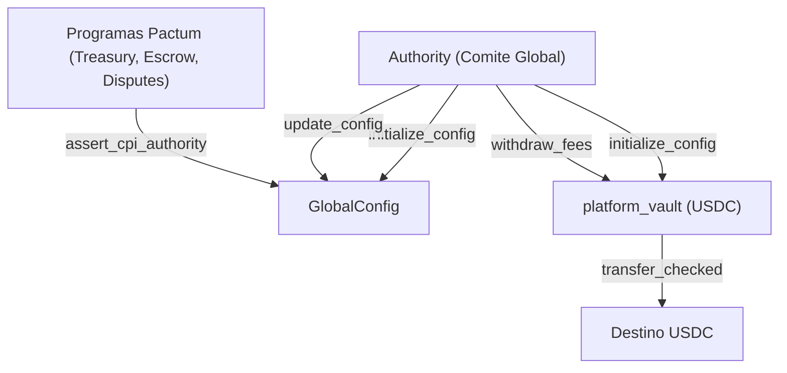

# Guía `pactum-config` (as implemented)

> **As implemented** — documenta el programa `programs/pactum-config` en `pactum-contracts` (`9ESE5Ztpr8zWbLyXCyiB5QqcjxHghotT8zqJxD2S3zaT`).
> **SoT técnica:** [pactum-programs-spec.md](../../docs/architecture/pactum-programs-spec.md).

`pactum-config` es la fuente única de verdad (*Source of Truth*) para los parámetros económicos globales (`protocol_fee_bps`, `max_protocol_fee`, `dispute_escalation_fee`), el *mint* USDC, la bóveda de comisiones (`platform_vault`), las credenciales base de SAS (`sas_program`, `sas_credential`) y la *allowlist* de programas para CPIs (`assert_cpi_authority`).

## Camino rápido

1. **Inicialización:** `initialize_config(params)` → crea `GlobalConfig` (`["global_config"]`) y la cuenta token `platform_vault` (`["platform_vault_token"]`) controlada por `platform_vault_pda`.
2. **Gobernanza / ajustes:** `update_config(params)` → permite a `authority` ajustar *fees* y credenciales SAS (`authority` y la *allowlist* de programas son inmutables tras `initialize_config`).
3. **Retiro de comisiones:** `withdraw_fees(amount)` → transfiere USDC desde `platform_vault` hacia una cuenta destino mediante `transfer_checked`.

### Diagrama de flujo

## Detalles

### Cuentas clave y seeds

| Cuenta | Seeds | Campos clave |
|--------|-------|--------------|
| `GlobalConfig` | `["global_config"]` | `authority`, `usdc_mint`, `platform_vault`, `platform_vault_bump`, `protocol_fee_bps`, `max_protocol_fee`, `dispute_escalation_fee`, `sas_program`, `sas_credential`, `core_program`, `escrow_program`, `disputes_program`, `treasury_program`, `is_initialized`, `bump` |
| `platform_vault` | `["platform_vault_token"]` | Token Account USDC cuya autoridad es `platform_vault_pda` (`["platform_vault"]`) |

### Instrucciones (`instructions/`)

| Instrucción | Quién firma | Para qué sirve |
|-------------|-------------|----------------|
| `initialize_config(params)` | `authority` | Crea `GlobalConfig` y la bóveda `platform_vault`; fija los IDs compilados de `core`, `escrow`, `disputes` y `treasury`, más `protocol_fee_bps`, `max_protocol_fee`, `dispute_escalation_fee`, `sas_program` y `sas_credential` |
| `update_config(params)` | `global_config.authority` | Actualiza parámetros económicos y credenciales SAS (`authority` y la *allowlist* de programas son inmutables tras `initialize_config`) |
| `withdraw_fees(amount)` | `global_config.authority` | Retira comisiones acumuladas en `platform_vault` hacia una cuenta USDC del mismo *mint* usando `transfer_checked` |

### Verificación

- `cargo test -p pactum-config`: **14/14** tests pasando (`6` unit tests de `cpi_authority` + `8` tests atomizados en LiteSVM).
- `cargo clippy --workspace --all-targets -- -Dwarnings` y `cargo fmt -p pactum-config -- --check` con **0 warnings**.

## Checklist

- [x] Una instrucción por archivo en `instructions/`
- [x] *Seeds* documentadas sobre `GlobalConfig` en `state.rs`
- [x] Tests atómicos por instrucción en LiteSVM (`14/14` pasando)

## Próximo paso

Refactorizar `stayke-treasury` → `pactum-treasury` para *staking* continuo de `Judge` y `ArbiterProfile`.
