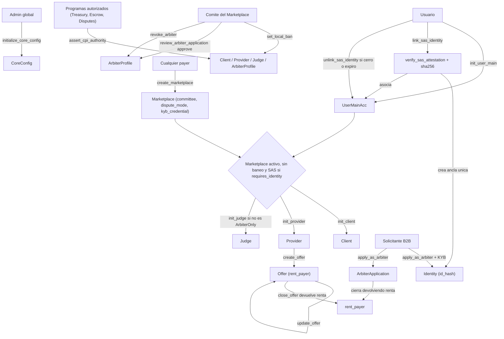

# Guía `pactum-core` (as implemented)

> **As implemented** — documenta el programa `programs/pactum-core` en `pactum-contracts` (`9g8fxn9YCSq4C4czHpCwn5PNpYmwEXCDN9h8qBehpQrW`).
> **SoT técnica:** [pactum-programs-spec.md](../../docs/architecture/pactum-programs-spec.md).

`pactum-core` centraliza la identidad raíz (`UserMainAcc`), la creación *permissionless* de `Marketplace`s sin dueño, los perfiles aislados por rol (`Client`, `Provider`, `Judge`), el catálogo reutilizable de `Offer`s y el registro B2B de árbitros (`ArbiterApplication` / `ArbiterProfile`). Toda mutación cruzada de métricas, *stakes* o disputas exige firma PDA `cpi_authority` validada contra `GlobalConfig` mediante `assert_cpi_authority`.

## Camino rápido

1. **Admin:** `initialize_core_config` → crea `CoreConfig` enlazado a `GlobalConfig`.
2. **Usuario:** `init_user_main` → crea `UserMainAcc`; si el mercado exige identidad (`requires_identity == true`), enlaza su *attestation* con `link_sas_identity`.
3. **Mercado (permissionless):** `create_marketplace(market_id, params)` → define `committee`, `dispute_mode` (`ArbiterOnly` | `DecentralizedJury` | `Hybrid`), `requires_identity` y mínimos de *stake*/*fee*.
4. **Participantes:** `init_client`, `init_provider` o `init_judge` (este último bloqueado si `dispute_mode == ArbiterOnly`).
5. **Ofertas:** `create_offer(params)`, `update_offer(params)` y `close_offer` (devuelve renta exclusivamente a `offer.rent_payer`).
6. **Árbitros B2B:** `apply_as_arbiter(arbiter_fee, sla_secs, id_hash)` → `review_arbiter_application(approve)` (comité crea `ArbiterProfile` solo si aprueba y cierra `ArbiterApplication` → `rent_payer`) → `revoke_arbiter`.

### Diagrama de flujo

## Detalles

### Cuentas clave y seeds

| Cuenta | Seeds | Campos clave |
|--------|-------|--------------|
| `CoreConfig` | `["core_config"]` | `authority`, `global_config`, `bump` |
| `UserMainAcc` | `["user_main", authority]` | `authority`, `sas_attestation: Option<Pubkey>`, `bump` |
| `Identity` | `["identity", id_hash]` | `authority`, `verified_at`, `linked`, `bump` *(ancla de unicidad anti-Sybil por hash KYC/KYB)* |
| `Marketplace` | `["marketplace", market_id]` | `market_id`, `name`, `committee`, `dispute_mode`, `storage_backend`, `integrator_policy`, `kyb_credential`, `client_requires_kyc`, `provider_identity`, `judge_identity`, `min_judge_stake`, `max_judge_stake`, `min_arbiter_stake`, `min_jury_fee`, `pool_count`, `is_active`, `bump` |
| `Client` | `["client", marketplace, user_main]` | `marketplace`, `user_main`, `is_banned`, `completed_agreements`, `cancelled_agreements`, `disputes_won`, `disputes_lost`, `total_reviews`, `total_score`, `bump` |
| `Provider` | `["provider", marketplace, user_main]` | `marketplace`, `user_main`, `is_banned`, `offer_count`, `completed_agreements`, `cancelled_agreements`, `disputes_won`, `disputes_lost`, `total_reviews`, `total_score`, `bump` |
| `Judge` | `["judge", marketplace, user_main]` | `marketplace`, `user_main`, `staked_amount`, `pool_id`, `leaf_index`, `is_active_in_pool`, `active_disputes`, `cases_voted`, `cases_in_consensus`, `is_banned`, `bump` |
| `Offer` | `["offer", provider, offer_id]` | `offer_id`, `base_price`, `pricing_type`, `approval_window_secs`, `provider_bond`, `required_client_bond`, `jury_fee`, `default_arbiter`, `content_ref`, `state_hash`, `is_active`, `rent_payer`, `bump` |
| `ArbiterApplication` | `["arbiter_app", marketplace, authority]` | `marketplace`, `authority`, `sas_kyb_attestation`, `arbiter_fee`, `sla_secs`, `rent_payer`, `bump` |
| `ArbiterProfile` | `["arbiter", marketplace, authority]` | `marketplace`, `authority`, `sas_kyb_attestation`, `arbiter_fee`, `staked_amount`, `sla_secs`, `active_disputes`, `cases_resolved`, `is_active`, `bump` |
| `IntegratorApplication` | `["integrator_app", marketplace, authority]` | `marketplace`, `authority`, `sas_kyb_attestation`, `default_fee_bps`, `rent_payer`, `bump` |
| `IntegratorProfile` | `["integrator", marketplace, authority]` | `marketplace`, `authority`, `sas_kyb_attestation`, `default_fee_bps`, `fallback_resolutions`, `is_active`, `is_banned`, `bump` |

*(Nota: `Provider` ya no guarda `deposited_bond` global; el bond opcional vive aislado por `Agreement` en escrow.)*

### Instrucciones públicas (`instructions/`)

| Categoría | Instrucción | Quién firma | Para qué sirve |
|-----------|-------------|-------------|----------------|
| **Identidad / Admin** | `initialize_core_config` | `global_config.authority` | Enlaza `pactum-core` con `GlobalConfig` al desplegar el protocolo |
| | `init_user_main` | `authority`, `payer` | Crea la cuenta raíz `UserMainAcc` del usuario (sin identidad aún) |
| | `link_sas_identity(id_hash)` | `authority`, `payer` | Verifica *attestation* + `Credential` SAS, comprueba `sha256(attestation.data) == id_hash`, crea `Identity(id_hash)` anti-Sybil y la enlaza a `UserMainAcc` |
| | `unlink_sas_identity` | `authority` | Desvincula `sas_attestation` solo si fue cerrada o expiró en SAS, conservando `Identity(id_hash)` para evitar re-registro en otra wallet |
| **Mercados / Roles** | `create_marketplace(market_id, params)` | `payer` *(permissionless)* | Crea un `Marketplace` sin dueño con su `committee`, `dispute_mode`, `storage_backend`, `kyb_credential` opcional y mínimos de *stake*/*fee* |
| | `update_marketplace(params)` | `marketplace.committee` | Permite al comité (o gobernanza DAO futura) ajustar límites de *stake* (`min/max_judge_stake`, `min_arbiter_stake`), `min_jury_fee`, `kyb_credential`, `requires_identity`, `is_active` o rotar `committee` |
| | `init_client` | `authority`, `payer` | Registra el perfil `Client` en un `Marketplace` (exige mercado activo y SAS si `client_requires_kyc == true`) |
| | `init_provider` | `authority`, `payer` | Registra el perfil `Provider` en un `Marketplace` para publicar ofertas (exige mercado activo y SAS si `provider_identity` lo requiere) |
| | `init_judge` | `authority`, `payer` | Registra el perfil `Judge` para jurados en un `Marketplace` (rechaza mercados `ArbiterOnly`) |
| | `set_local_ban(role, banned)` | `marketplace.committee` | Veta o rehabilita localmente un `Client`, `Provider` o `Judge` dentro de un `Marketplace` |
| **Ofertas** | `create_offer(params)` | `authority`, `payer` | Publica una `Offer` reutilizable (fija `offer_id`, incrementa `provider.offer_count` y guarda `rent_payer`) |
| | `update_offer(params)` | `authority` | Actualiza precio base, *bonds*, `default_arbiter`, `content_ref`, `state_hash` o visibilidad (`is_active`) |
| | `close_offer` | `authority` | Cierra una `Offer` y devuelve el 100 % de la renta únicamente a `offer.rent_payer` |
| **Árbitros B2B** | `apply_as_arbiter(arbiter_fee, sla_secs, id_hash)` | `authority`, `payer` | Valida *attestation* KYB contra `marketplace.kyb_credential` (o `global_config.sas_credential`), ancla `Identity(id_hash)` con `init_if_needed` (permite misma wallet en varios mercados) y crea `ArbiterApplication` |
| | `review_arbiter_application(approve)` | `marketplace.committee` | Aprueba (crea `ArbiterProfile`) o rechaza la solicitud; en ambos casos cierra `ArbiterApplication` devolviendo la renta a `rent_payer` |
| | `revoke_arbiter` | `marketplace.committee` | Desactiva un `ArbiterProfile` (`is_active = false`) en el mercado |
| **Integradores** | `init_integrator(default_fee_bps)` | `authority`, `payer` | Crea `IntegratorProfile` directamente en mercados con `IntegratorPolicy::Permissionless` |
| | `apply_as_integrator(default_fee_bps, id_hash)` | `authority`, `payer` | Crea `IntegratorApplication` en mercados `CommitteeApproval` / `KybAndCommittee` (valida SAS KYB + `Identity` si aplica) |
| | `review_integrator_application(approve)` | `marketplace.committee` | Aprueba (crea `IntegratorProfile`) o rechaza la solicitud y cierra `IntegratorApplication` → `rent_payer` |
| | `revoke_integrator` | `marketplace.committee` | Desactiva un `IntegratorProfile` (`is_active = false`) en el mercado |

### Mutadores CPI privilegiados (`instructions/cpi/`)

Requieren `cpi_authority` (PDA del programa llamador) validada con `assert_cpi_authority`:

| Instrucción | Caller permitido | Para qué sirve |
|-------------|------------------|----------------|
| `cpi_update_judge_stake(amount, is_stake, pool_id, leaf_index)` | `Treasury` | Sincroniza el *stake* y posición (`pool_id`, `leaf_index`) del `Judge` tras depositar o retirar |
| `cpi_update_arbiter_stake(amount, is_stake)` | `Treasury` | Sincroniza `arbiter_profile.staked_amount` tras depositar, retirar o sufrir *slashing* |
| `cpi_record_agreement_outcome(role, outcome)` | `Escrow` | Registra si un acuerdo terminó `Completed` o `Cancelled` en `Client` o `Provider` |
| `cpi_update_role_review(role, score)` | `Escrow` | Acumula una calificación (`1..=5`) en `total_reviews` y `total_score` de `Client` o `Provider` |
| `cpi_update_active_disputes(target_role, delta)` | `Disputes` | Incrementa o decrementa `active_disputes` de `Judge` o `ArbiterProfile` para bloquear retiros mientras tenga casos abiertos |
| `cpi_record_dispute_result(winner)` | `Disputes` | Suma `disputes_won` / `disputes_lost` en `Client` y `Provider` al cerrar una disputa |
| `cpi_record_judge_vote(in_consensus)` | `Disputes` | Incrementa `cases_voted` (y `cases_in_consensus` si votó con la mayoría) en `Judge` |
| `cpi_record_arbiter_resolution` | `Disputes` | Incrementa `arbiter_profile.cases_resolved` cuando un árbitro B2B resuelve un caso |

### Verificación

- Suite atomizada por instrucción en `programs/pactum-core/tests/` (16 archivos en LiteSVM + unit test): todos pasando con **0 warnings**.
- `cargo fmt -p pactum-core -- --check` y `cargo clippy -p pactum-core --all-targets -- -Dwarnings` con **0 warnings**.

## Checklist

- [x] Una instrucción por archivo en `instructions/` y CPIs aislados en `instructions/cpi/`
- [x] *Seeds* documentadas sobre cada struct `#[account]` en `state/`
- [x] Devolución estricta de renta a `rent_payer` en `close_offer` y `review_arbiter_application`
- [x] Unicidad anti-Sybil por `Identity(id_hash)` (`sha256(attestation.data)`) en `link_sas_identity` y `apply_as_arbiter`
- [x] Tests atómicos por instrucción en LiteSVM pasando con **0 warnings**

## Próximo paso

Migrar `pactum-config` (completar `protocol_fee_bps`, `max_protocol_fee`, `dispute_escalation_fee` y `update_config`) y continuar con `pactum-escrow`.
