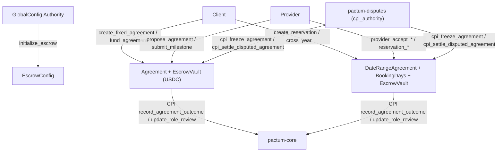

# `pactum-escrow` Guide (as implemented)

> **Program ID:** `68ipZiXiUhsaSYSqEM3619vXgKy5CqFmNE6rYzxrXu6a` (`programs/pactum-escrow`)  
> **Refactor Plan:** [`docs/pactum-escrow.plan.md`](./pactum-escrow.plan.md)

`pactum-escrow` manages USDC escrow custody, optimistic milestone releases, date-range reservation calendars, cancellation splits, counterparty reviews, and dispute settlement for the Pactum protocol. It uses a 2-struct state model—`Agreement` (for `OneTime` and `Milestones` deals) and `DateRangeAgreement` + `BookingDays` (for `DateRange` reservations)—with an isolated `EscrowVault` token account per deal and CPI hooks into `pactum-core` and `pactum-disputes`.

## Architecture Overview

## Accounts and PDA Seeds

| Account | Seeds | Purpose |
|---|---|---|
| `EscrowConfig` | `["escrow_config"]` | Global escrow configuration (`authority`, `global_config`, `is_initialized`, `bump`). |
| `Agreement` | `["agreement", offer, client, nonce.to_le_bytes()]` | State for `OneTime` (1 milestone) and `Milestones` (`1..=20`) agreements. |
| `DateRangeAgreement` | `["date_range_agreement", offer, client, check_in.to_le_bytes()]` | State for `DateRange` reservations including cancellation policy snapshot and bonds. |
| `BookingDays` | `["booking_days", offer, year.to_le_bytes()]` | 12-month bitmask (`[u32; 12]`) preventing double-booking per offer and calendar year. |
| `EscrowVault` | `["escrow_vault", agreement_or_reservation]` | Self-custodied USDC token account (`token::authority = escrow_vault`) holding deal principal and bonds. |

## Key Constants and Windows

| Constant | Value | Meaning |
|---|---|---|
| `MAX_MILESTONES` | `20` | Maximum milestone count on `Agreement`. |
| `ACCEPT_WINDOW_SECS` | `86_400` (24h) | Window for provider to accept a `Pending` agreement/reservation before expiry. |
| `PROPOSAL_EXPIRY_SECS` | `604_800` (7d) | Window for client to fund a `Proposed` agreement before expiry. |
| `POST_CHECKOUT_RELEASE_WINDOW_SECS` | `86_400` (24h) | Grace window after `check_out` before permissionless `release_reservation_funds`. |
| `REVIEW_WINDOW_SECS` | `345_600` (4d) | Post-completion window during which `review_counterparty` is allowed; after this, accounts can be closed without losing review rights. |
| `DEFAULT_CANCELLATION_WINDOW_HOURS` | `72` (3d) | Default notice threshold for `CancellationPolicy::Default` / `Custom`. |
| `DEFAULT_CLIENT_REFUND_PCT` | `60` | Default client refund percentage when cancelling inside the notice window. |

## Instruction Lifecycles

### 1. Admin (`instructions/admin/`)

- **`initialize_escrow`**: Initializes `EscrowConfig` linked to `GlobalConfig` (`global_config.authority` signer).

### 2. Milestones & One-Time Agreements (`instructions/milestones/`)

Two entry paths converge at `Funded`:

- **Client-initiated (Fixed price):**
  1. `create_fixed_agreement` → deposits `total_amount + client_bond` into `EscrowVault` (`Pending`).
  2. `provider_accept_agreement` → deposits `provider_bond` (`Funded`), OR `provider_reject_agreement` / `expire_agreement` (after `ACCEPT_WINDOW_SECS`) → refunds client and closes accounts (`Cancelled`).
- **Provider-initiated (Custom proposal):**
  1. `propose_agreement` → provider deposits `provider_bond` (`Proposed`).
  2. `fund_agreement` → client deposits `total_amount + client_bond` (`Funded`), OR `cancel_proposal` / `expire_proposal` (after `PROPOSAL_EXPIRY_SECS`) → refunds provider bond and closes accounts (`Cancelled`).
- **Execution & Settlement:**
  1. `submit_milestone` → provider records `deliverable_hash` before `current_deadline_ts` (`Submitted`).
  2. `approve_milestone` (client) OR `claim_milestone` (permissionless optimistic release after `submitted_at + approval_window_secs`) → pays milestone net of `integrator_fee_bps` (if configured), advances `completed_milestones`, and on final milestone returns bonds, records outcomes in `pactum-core` via CPI, and sets `Completed`.
  3. `cancel_agreement` → cooperative or post-deadline cancellation with bond/principal settlement.

### 3. Date-Range Reservations (`instructions/reservations/`)

Supports same-year and Dec→Jan cross-year stays (`BookingDays` for `year` and `year + 1`):

1. **Booking:** `create_reservation` / `create_reservation_cross_year` → locks day bits in `BookingDays`, deposits `total_amount + client_bond` (`Pending`).
2. **Provider Response:** `provider_accept_reservation` → deposits `provider_bond` (`Accepted`), OR `provider_reject_reservation[_cross_year]` / `expire_reservation[_cross_year]` → clears day bits, refunds client, and closes vault (`Cancelled`).
3. **Check-in / Check-out / Release:**
   - `reservation_starts` (`>= check_in`) → `Active`.
   - `reservation_completes` (`>= check_out`) → `Completed`.
   - `release_reservation_funds` (client anytime in `Completed`, or permissionless after `check_out + POST_CHECKOUT_RELEASE_WINDOW_SECS`) → transfers net payout + integrator fee + bonds, records outcomes in `pactum-core`, sets `Released`.
4. **Cancellations:**
   - `client_cancel_reservation[_cross_year]`: applies `CancellationPolicy` (`Strict`, `Flexible`, `Default`, `Custom`) against hours remaining before `check_in`, splitting principal and clearing day bits.
   - `provider_cancel_reservation[_cross_year]`: refunds client 100% + `client_bond` and penalizes `provider_bond` by `provider_cancellation_penalty_pct` (inside window) or returns full bond (outside window).

### 4. Shared & Cleanup (`instructions/`)

- **`review_counterparty`**: Allows `client` or `provider` to submit a 1–5 star rating within `REVIEW_WINDOW_SECS` of completion/release, updating `pactum-core` reputation via CPI (`cpi_update_role_review`).
- **`close_agreement` / `close_reservation`**: Closes settled (`Completed`/`Released`/`Cancelled`) accounts and reclaims rent to `rent_payer` once both parties have reviewed or `REVIEW_WINDOW_SECS` has elapsed.

### 5. Dispute CPI Hooks (`instructions/cpi/`)

Authorized exclusively via `pactum_config::assert_cpi_authority(..., &[AllowedCaller::Disputes])`:

- **`cpi_freeze_agreement`**: Transitions an active `Agreement` or `DateRangeAgreement` into `Disputed`, preserving `previous_status` so state cannot advance while a dispute is open.
- **`cpi_settle_disputed_agreement`**: Distributes escrowed principal + bonds between client, provider, integrator, and `jury_fee` recipient according to the dispute ruling, records outcomes in `pactum-core`, and marks the deal `Completed` / `Released`.

## Verification

Full workspace gate verified across `pactum-config`, `pactum-core`, `pactum-treasury`, and `pactum-escrow`:

- `cargo +nightly fmt --all -- --check` — clean
- `cargo deny check advisories` — `advisories ok`
- `cargo clippy --all-targets --tests -- -Dwarnings` — 0 warnings
- `NO_DNA=1 anchor build -p pactum_escrow --ignore-keys` — clean
- `cargo test --all-targets` — all unit and LiteSVM integration tests passing (including 1 atomic test file per instruction in `programs/pactum-escrow/tests/`)
