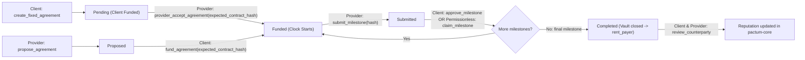

# `pactum-escrow` Refactor Plan

> **Status:** Planned (awaiting review before Commit 0)
> **Scope:** `programs/pactum-escrow` (plus a small `Offer.cancellation_policy` extension in `programs/pactum-core`)

---

## 1. Scope & Boundaries

### In Scope
1. **Prerequisite (`pactum-core`):**
   - Add optional `CancellationPolicy` (`window_hours`, `client_refund_pct`) to `Offer` (`create_offer` / `update_offer`) so `DateRange` offers define custom per-offer client-cancellation percentages on-chain.
   - Add `provider_cancellation_penalty_pct: u8` (`0..=100`) to `Marketplace` (`create_marketplace` / `update_marketplace`) so a neutral market parameter — never the provider or client unilaterally — defines the provider's cancellation slash.
2. **New program `programs/pactum-escrow`:** Wired into workspace `Cargo.toml` and `Anchor.toml`.
3. **Two-struct agreement model:**
   - `Agreement` for `Milestones` and `OneTime` offers.
   - `DateRangeAgreement` + `BookingDays` for `DateRange` reservations.
4. **Shared `EscrowConfig` & `EscrowVault`:** Isolated per-agreement USDC vault (holding 100% of agreement funds + optional `provider_bond` + optional `client_bond`).
5. **Cross-program integration:**
   - `pactum-config`: `GlobalConfig` (`usdc_mint`, `platform_vault`, `protocol_fee_bps`, `max_protocol_fee`) and `assert_cpi_authority`.
   - `pactum-core`: `cpi_record_agreement_outcome` and `cpi_update_role_review`.
   - `pactum-disputes`: CPI endpoints `cpi_freeze_agreement` and `cpi_settle_disputed_agreement`.
6. **Atomic LiteSVM tests:** One test file per instruction (`tests/test_<instruction>.rs`) following `RULES.md` and `skills/testing.md`.
7. **Documentation:** `docs/pactum-escrow.guide.md` upon completion.

### Out of Scope
- `stayke-disputes` → `pactum-disputes` refactor (handled in the next phase; `pactum-escrow` only exposes its CPI endpoints).
- Modifying `pactum-config` or `pactum-treasury`.
- Codama TypeScript client regeneration (`packages/`).

---

## 2. Folder Layout

```text
programs/pactum-escrow/
├── Cargo.toml
├── src/
│   ├── lib.rs
│   ├── constants.rs
│   ├── error.rs
│   ├── events.rs
│   ├── utils.rs
│   ├── state/
│   │   ├── mod.rs
│   │   ├── config.rs               # EscrowConfig
│   │   ├── agreement.rs            # Agreement + AgreementStatus
│   │   └── date_range_agreement.rs # DateRangeAgreement + DateRangeStatus + BookingDays
│   └── instructions/
│       ├── mod.rs
│       ├── admin/
│       │   └── initialize_escrow.rs
│       ├── milestones/
│       │   ├── create_fixed_agreement.rs
│       │   ├── provider_accept_agreement.rs
│       │   ├── provider_reject_agreement.rs
│       │   ├── expire_agreement.rs
│       │   ├── propose_agreement.rs
│       │   ├── fund_agreement.rs
│       │   ├── cancel_proposal.rs
│       │   ├── expire_proposal.rs
│       │   ├── submit_milestone.rs
│       │   ├── approve_milestone.rs
│       │   ├── claim_milestone.rs
│       │   └── cancel_agreement.rs
│       ├── reservations/
│       │   ├── create_reservation.rs
│       │   ├── create_reservation_cross_year.rs
│       │   ├── provider_accept_reservation.rs
│       │   ├── provider_reject_reservation.rs
│       │   ├── provider_reject_reservation_cross_year.rs
│       │   ├── expire_reservation.rs
│       │   ├── expire_reservation_cross_year.rs
│       │   ├── reservation_starts.rs
│       │   ├── reservation_completes.rs
│       │   ├── release_reservation_funds.rs
│       │   ├── client_cancel_reservation.rs
│       │   ├── client_cancel_reservation_cross_year.rs
│       │   ├── provider_cancel_reservation.rs
│       │   └── provider_cancel_reservation_cross_year.rs
│       ├── review_counterparty.rs
│       ├── close_agreement.rs
│       ├── close_reservation.rs
│       └── cpi/
│           ├── cpi_freeze_agreement.rs
│           └── cpi_settle_disputed_agreement.rs
└── tests/
    ├── common/mod.rs
    └── test_<instruction>.rs       # 1 file per instruction
```

---

## 3. Account Structures & Seeds

### Prerequisite: `Offer.cancellation_policy` & `Marketplace.provider_cancellation_penalty_pct` (`pactum-core`)
```rust
#[derive(AnchorSerialize, AnchorDeserialize, Clone, Copy, Debug, PartialEq, Eq, InitSpace)]
pub struct CancellationPolicy {
    /// Hours before check-in inside which client cancellation splits apply.
    pub window_hours: u32,
    /// Percentage (0..=100) of total_amount refunded to client inside the window.
    pub client_refund_pct: u8,
}
```
Validation in `pactum-core`:
- `Offer` (`create_offer` / `update_offer`): `client_refund_pct <= 100`. If `None` on a `DateRange` offer, `pactum-escrow` falls back to protocol defaults (`72h`, `60%`).
- `Marketplace` (`create_marketplace` / `update_marketplace`): `provider_cancellation_penalty_pct <= 100` (e.g., `10%` default in tests/markets).

---

### `EscrowConfig`
> Seeds: `["escrow_config"]`
- `authority: Pubkey` (`global_config.authority`)
- `global_config: Pubkey`
- `is_initialized: bool`
- `bump: u8`

---

### `EscrowVault` (SPL Token Account PDA)
> Seeds: `["escrow_vault", agreement_or_reservation.key().as_ref()]`
- `token::mint = global_config.usdc_mint`
- `token::authority = escrow_vault`
- Holds `total_amount + provider_bond + client_bond` (isolated per agreement; closed to `rent_payer` on terminal settlement).

---

### `Agreement` (`Milestones` / `OneTime`)
> Seeds: `["agreement", offer.key().as_ref(), client.key().as_ref(), &nonce.to_le_bytes()]`
> *(Omits redundant `marketplace` — verified via `client.marketplace` / `provider.marketplace`; `milestone_amounts` uses dynamic Borsh `Vec<u64>` sized via `Agreement::space(count)` at `init`.)*

| Field | Type | Purpose |
|---|---|---|
| `nonce` | `u64` | Allows multiple agreements per `(offer, client)` |
| `offer` | `Pubkey` | Source `Offer` |
| `client` | `Pubkey` | `pactum-core` `Client` PDA |
| `provider` | `Pubkey` | `pactum-core` `Provider` PDA |
| `integrator` | `Option<Pubkey>` | Optional `IntegratorProfile` PDA |
| `integrator_fee_bps` | `u16` | Snapshot of integrator fee bps |
| `arbiter` | `Option<Pubkey>` | Snapshot of `offer.default_arbiter` or custom arbiter |
| `jury_fee` | `u64` | Snapshot of `offer.jury_fee` |
| `total_amount` | `u64` | Total escrowed USDC (sum of milestones) |
| `provider_bond` | `u64` | Isolated optional provider bond |
| `client_bond` | `u64` | Isolated optional client bond |
| `released_amount` | `u64` | Cumulative USDC released so far |
| `milestone_amounts` | `Vec<u64>` | Dynamic per-milestone amounts (`OneTime` = 1 element; `1..=MAX_MILESTONES`) |
| `completed_milestones` | `u8` | Milestones released so far |
| `step_duration_secs` | `i64` | Strict duration per milestone |
| `current_deadline_ts` | `i64` | Advances by `step_duration_secs` on each release |
| `approval_window_secs` | `i64` | Optimistic release window after submission |
| `submitted_at` | `i64` | Timestamp of current deliverable submission |
| `completed_at` | `i64` | Timestamp of terminal state (drives 96h review window before close) |
| `deliverable_hash` | `[u8; 32]` | Latest submitted deliverable hash |
| `state_hash` | `[u8; 32]` | Snapshot of `offer.state_hash` |
| `deal_contract_hash` | `Option<[u8; 32]>` | Optional off-chain contract hash |
| `status` | `AgreementStatus` | `Pending \| Proposed \| Funded \| Submitted \| Completed \| Disputed \| Cancelled` |
| `previous_status` | `Option<AgreementStatus>` | Restored if P2P dispute withdraws / `NoFaultFound` |
| `client_reviewed` | `bool` | 1-review-per-party guard |
| `provider_reviewed` | `bool` | 1-review-per-party guard |
| `rent_payer` | `Pubkey` | Strict rent reclamation target |
| `escrow_vault_bump` | `u8` | Vault PDA bump |
| `bump` | `u8` | Account bump |

---

### `DateRangeAgreement` (`DateRange` Reservations)
> Seeds: `["date_range_agreement", offer.key().as_ref(), client.key().as_ref(), &check_in.to_le_bytes()]`

| Field | Type | Purpose |
|---|---|---|
| `marketplace` | `Pubkey` | Market reference |
| `offer` | `Pubkey` | Source `DateRange` `Offer` |
| `client` | `Pubkey` | `pactum-core` `Client` PDA |
| `provider` | `Pubkey` | `pactum-core` `Provider` PDA |
| `integrator` | `Option<Pubkey>` | Optional `IntegratorProfile` PDA |
| `integrator_fee_bps` | `u16` | Snapshot of integrator fee bps |
| `arbiter` | `Option<Pubkey>` | Snapshot of arbiter |
| `jury_fee` | `u64` | Snapshot of jury fee |
| `check_in` | `i64` | Unix timestamp (start of stay) |
| `check_out` | `i64` | Unix timestamp (end of stay) |
| `total_amount` | `u64` | Total escrowed USDC (`nights * base_price`) |
| `provider_bond` | `u64` | Isolated optional provider bond |
| `client_bond` | `u64` | Isolated optional client bond |
| `cancellation_policy` | `CancellationPolicy` | **Snapshot** from `Offer` at creation (prevents mid-stay rug) |
| `provider_cancellation_penalty_pct` | `u8` | **Snapshot** from `Marketplace` at creation |
| `state_hash` | `[u8; 32]` | Snapshot of `offer.state_hash` |
| `status` | `DateRangeStatus` | `Pending \| Accepted \| Active \| Completed \| Released \| Disputed \| Cancelled` |
| `previous_status` | `Option<DateRangeStatus>` | Restored if P2P dispute withdraws / `NoFaultFound` |
| `updated_at` | `i64` | Drives 24h accept expiry & 24h post-checkout release window |
| `client_reviewed` | `bool` | 1-review-per-party guard |
| `provider_reviewed` | `bool` | 1-review-per-party guard |
| `rent_payer` | `Pubkey` | Strict rent reclamation target |
| `escrow_vault_bump` | `u8` | Vault PDA bump |
| `bump` | `u8` | Account bump |

### `BookingDays`
> Seeds: `["booking_days", offer.key().as_ref(), &year.to_le_bytes()]`
- `occupied_days: [u32; 12]`
- `year: u32`
- `bump: u8`

---

## 4. Happy Paths (Detailed Walkthrough)

### Happy Path A — `Milestones` / `OneTime` (`Agreement`)



1. **Creation & Mutual Consent (2-TX for both Fixed and Custom)**
   - **Client-first (`create_fixed_agreement` → `provider_accept_agreement`):**
     - `create_fixed_agreement`: Requires `offer.pricing_type == Fixed` (or `OneTime` equivalent with `base_price: Some(price)`), `offer.is_active == true`, `marketplace.is_active == true`, neither party banned. Client optionally passes `deal_contract_hash: Option<[u8; 32]>`, initializes `Agreement` (`status = Pending`, **deadline clock does NOT start**) + `EscrowVault`, and deposits `total_amount + client_bond`.
     - `provider_accept_agreement(expected_contract_hash)`: Provider signs, enforces `agreement.deal_contract_hash == expected_contract_hash`, deposits `provider_bond` (if `> 0`), sets `status = Funded`, and starts `current_deadline_ts = now + step_duration_secs`. (If the provider rejects or misses the accept window, `provider_reject_agreement` or `expire_agreement` refunds 100% to client and closes `EscrowVault` + `Agreement` → `rent_payer`.)
   - **Provider-first (`propose_agreement` → `fund_agreement`):**
     - `propose_agreement`: Provider signs, sets custom `milestone_amounts`, `step_duration_secs`, `deal_contract_hash`, deposits `provider_bond` (if `> 0`) into `EscrowVault`, sets `status = Proposed`.
     - `fund_agreement(expected_contract_hash)`: Client signs, verifies `status == Proposed` and `agreement.deal_contract_hash == expected_contract_hash`, deposits `total_amount + client_bond` into `EscrowVault`, sets `status = Funded` and starts `current_deadline_ts = now + step_duration_secs`.
2. **Delivery (`submit_milestone`)**
   - Requires `status == Funded`, `provider.authority` signer, `now <= current_deadline_ts`.
   - Stores `deliverable_hash`, sets `submitted_at = now`, `status = Submitted`.
3. **Release (`approve_milestone` or `claim_milestone`)**
   - `approve_milestone`: Requires `status == Submitted` and `client.authority` signer.
   - `claim_milestone`: Requires `status == Submitted` and `now >= submitted_at + approval_window_secs` (permissionless optimistic release).
   - **Fee & payout calculation for `amount = milestone_amounts[completed_milestones]`:**
     - `protocol_fee = min(amount * global_config.protocol_fee_bps / 10_000, global_config.max_protocol_fee)` (if `max_protocol_fee > 0`, else uncapped bps).
     - `integrator_fee = amount * agreement.integrator_fee_bps / 10_000` (if `integrator.is_some()`, else `0`).
     - `provider_payout = amount - protocol_fee - integrator_fee`.
   - Transfers `protocol_fee` → `global_config.platform_vault`, `integrator_fee` → integrator USDC account (if `> 0`), `provider_payout` → provider USDC account.
   - Updates `released_amount += amount`, `completed_milestones += 1`.
4. **Milestone Loop vs Final Settlement**
   - **If `completed_milestones < milestone_count`:** `status = Funded`, `current_deadline_ts += step_duration_secs`.
   - **If `completed_milestones == milestone_count` (Final):**
     - `status = Completed`.
     - Transfers `provider_bond` → provider USDC account (if `> 0`) and `client_bond` → client USDC account (if `> 0`).
     - Closes `EscrowVault` → returns token account rent lamports to `agreement.rent_payer`.
     - CPI to `pactum-core::cpi_record_agreement_outcome(Client, Completed)` and `cpi_record_agreement_outcome(Provider, Completed)`.
5. **Post-Completion Reviews (`review_counterparty`)**
   - Requires `status == Completed` (or `Disputed` resolved), `rating in 1..=5`.
   - Guards `client_reviewed` / `provider_reviewed` so each party can review at most once.
   - CPI to `pactum-core::cpi_update_role_review(counterparty_role, rating)`.

---

### Happy Path B — `DateRange` Reservations (`DateRangeAgreement`)


1. **Create & Fund (`create_reservation` / `create_reservation_cross_year`)**
   - Requires `offer.pricing_type == DateRange`, `offer.base_price: Some(nightly_rate)`, `offer.is_active`, `marketplace.is_active`, neither party banned.
   - Validates `check_in < check_out` and `check_in > now`.
   - Marks calendar bits in `BookingDays` (1 account same-year, 2 accounts cross-year; rejects if any day already occupied).
   - Snapshots `offer.cancellation_policy` (or defaults) and `offer.state_hash`.
   - Initializes `DateRangeAgreement` (`status = Pending`, `updated_at = now`, `rent_payer = payer.key()`).
   - Initializes `EscrowVault` and transfers `total_amount + client_bond` from client's USDC account into `EscrowVault`.
2. **Provider Acceptance (`provider_accept_reservation`)**
   - Requires `status == Pending`, `provider.authority` signer, `now <= updated_at + 24h`.
   - If `provider_bond > 0`, provider deposits `provider_bond` into `EscrowVault` on acceptance.
   - Sets `status = Accepted`, `updated_at = now`.
3. **Check-in (`reservation_starts` — Permissionless)**
   - Requires `status == Accepted` and `now >= check_in`.
   - Sets `status = Active`, `updated_at = now`.
4. **Check-out (`reservation_completes` — Permissionless)**
   - Requires `status == Active` and `now >= check_out`.
   - Sets `status = Completed`, `updated_at = now` (starts the 24h post-stay dispute/release window).
5. **Settlement (`release_reservation_funds` — Permissionless)**
   - Requires `status == Completed` and `now >= updated_at + 24h`.
   - Computes `protocol_fee` (using `global_config.protocol_fee_bps` & `max_protocol_fee`), `integrator_fee` (if `integrator.is_some()`), and `provider_payout = total_amount - protocol_fee - integrator_fee`.
   - Transfers payouts from `EscrowVault`, refunds `client_bond` → client and `provider_bond` → provider.
   - Closes `EscrowVault` → returns rent lamports to `reservation.rent_payer`.
   - Sets `status = Released`.
   - CPI to `pactum-core::cpi_record_agreement_outcome(Client, Completed)` and `cpi_record_agreement_outcome(Provider, Completed)`.
6. **Reviews (`review_counterparty`)**
   - Same as Happy Path A (allowed in `Released` or dispute-settled terminal state).

---

## 5. Unhappy Paths

1. **Pending Agreement Rejected / Expired (`Agreement` in `Pending`)**
   - `provider_reject_agreement` (Provider) or `expire_agreement` (Permissionless after accept window):
   - Refunds `total_amount + client_bond` → client, closes `EscrowVault` and `Agreement` → `rent_payer`.
2. **Unfunded Proposal Cancelled / Expired (`Agreement` in `Proposed`)**
   - `cancel_proposal` (Provider or Client) or `expire_proposal` (Permissionless after proposal expiry):
   - Refunds `provider_bond` (if deposited), closes `EscrowVault` (if created) and `Agreement` → `rent_payer`.
3. **Funded Agreement Cancelled Pre-Delivery (`Agreement` in `Funded`)**
   - `cancel_agreement` (`completed_milestones == 0`, mutual or pre-delivery rule):
   - Refunds `total_amount + client_bond` → client, `provider_bond` → provider, closes `EscrowVault` → `rent_payer`, sets `status = Cancelled`, CPI `Cancelled` to `pactum-core`.
4. **Reservation Rejected / Expired (`DateRangeAgreement` in `Pending`)**
   - `provider_reject_reservation[_cross_year]` (Provider) or `expire_reservation[_cross_year]` (Permissionless if `now > updated_at + 24h`):
   - Releases `BookingDays` bits, refunds `total_amount + client_bond` → client, closes `EscrowVault` → `rent_payer`, sets `status = Cancelled`.
5. **Reservation Cancelled (`DateRangeAgreement` in `Accepted` before `check_in`)**
   - `client_cancel_reservation[_cross_year]`:
     - Releases `BookingDays` bits.
     - Outside `cancellation_policy.window_hours`: 100% `total_amount` + `client_bond` → client; `provider_bond` → provider.
     - Inside `cancellation_policy.window_hours`: `client_refund = total_amount * client_refund_pct / 100` → client; on `remainder = total_amount - client_refund`, deduct standard `protocol_fee_bps` (capped by `max_protocol_fee`) → `platform_vault` and `integrator_fee_bps` (if integrator present) → integrator, with the net remainder paid to provider; bonds returned.
     - Closes `EscrowVault` → `rent_payer`, sets `status = Cancelled`, CPI `Cancelled` to `pactum-core`.
   - `provider_cancel_reservation[_cross_year]`:
     - Releases `BookingDays` bits.
     - 100% `total_amount` + `client_bond` → client.
     - Inside `cancellation_policy.window_hours`: slashes `provider_cancellation_penalty_pct` of `provider_bond` → client, returns remainder → provider.
     - Closes `EscrowVault` → `rent_payer`, sets `status = Cancelled`, CPI `Cancelled` to `pactum-core`.
6. **Disputes (`cpi_freeze_agreement` / `cpi_settle_disputed_agreement` from `pactum-disputes`)**
   - Freeze: stores `previous_status`, sets `status = Disputed`.
   - P2P withdrawal / `NoFaultFound`: restores `status = previous_status`.
   - Verdict settlement: distributes remaining `EscrowVault` + bonds per verdict, pays `protocol_fee` / `integrator_fee` / `arbiter_or_jury_fee`, closes `EscrowVault` → `rent_payer`, sets terminal `Completed` or `Cancelled`.

---

## 6. Commit-by-Commit Plan (1 Instruction = 1 Commit)

Every commit passes the full gate before moving on:
`cargo +nightly fmt --all -- --check && cargo deny check advisories && cargo clippy --all-targets --tests -- -Dwarnings && anchor build && cargo test --all-targets`

1. **Commit 0:** `pactum-core` — Add `CancellationPolicy` to `Offer` (`create_offer`, `update_offer`) and `provider_cancellation_penalty_pct` to `Marketplace` (`create_marketplace`, `update_marketplace`) + tests.
2. **Commit 1:** `pactum-escrow` — Crate scaffold, `Cargo.toml`, `Anchor.toml`, `state/`, `constants.rs`, `error.rs`, `events.rs`, `utils.rs`.
3. **Commit 2:** `admin/initialize_escrow` + `test_initialize_escrow`.
4. **Commits 3–14:** `milestones/*` (12 instructions — one instruction + one test file per commit).
5. **Commits 15–28:** `reservations/*` (14 instructions — one instruction + one test file per commit).
6. **Commit 29–31:** `review_counterparty`, `close_agreement`, `close_reservation` + tests (96h review window + `emit!()` event trail before account closure).
7. **Commits 32–33:** `cpi/cpi_freeze_agreement` and `cpi/cpi_settle_disputed_agreement` + tests.
8. **Commit 34:** `docs/pactum-escrow.guide.md`.
