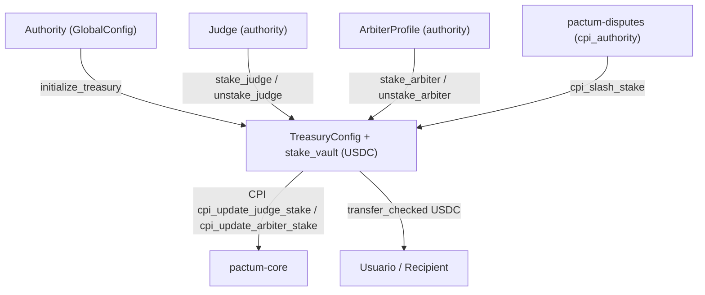

# Guía `pactum-treasury` (as implemented)

> **As implemented** — documenta el programa `programs/pactum-treasury` en `pactum-contracts` (`HV16vUTaZ78bJP1CyH5KDWyx8NqS1MYSGdPkRsMcnSuY`).
> **SoT técnica:** [pactum-programs-spec.md](../../docs/architecture/pactum-programs-spec.md).

`pactum-treasury` custodia únicamente los *stakes* continuos en USDC de `Judge` y `ArbiterProfile` dentro de `stake_vault`, manteniendo las garantías opcionales de cada acuerdo aisladas en `pactum-escrow`. Toda actualización de saldo en `pactum-core` se ejecuta vía CPI firmada por la PDA `cpi_authority` de `treasury`, y el *slashing* (`cpi_slash_stake`) solo puede invocarse vía CPI desde `pactum-disputes`.

## Camino rápido

1. **Admin:** `initialize_treasury` → crea `TreasuryConfig` (`["treasury_config"]`) y `stake_vault` (`["stake_vault"]`).
2. **Jurados (`Judge`):** `stake_judge(amount, pool_id, leaf_index)` deposita USDC y actualiza `Judge` vía CPI; `unstake_judge(amount)` retira si `active_disputes == 0`.
3. **Árbitros B2B (`ArbiterProfile`):** `stake_arbiter(amount)` deposita USDC (exige `is_active` y `>= min_arbiter_stake`); `unstake_arbiter(amount)` retira si `active_disputes == 0`.
4. **Slashing (solo CPI desde `pactum-disputes`):** `cpi_slash_stake(target_role, amount)` descuenta el *stake* en `pactum-core` y transfiere USDC desde `stake_vault` hacia `recipient_token_account`.

### Diagrama de flujo

## Detalles

### Cuentas clave y seeds

| Cuenta | Seeds | Campos clave |
|--------|-------|--------------|
| `TreasuryConfig` | `["treasury_config"]` | `authority`, `global_config`, `stake_vault`, `treasury_bump`, `is_initialized`, `bump` |
| `stake_vault` | `["stake_vault"]` | Token Account USDC controlada por `treasury_pda` (`["treasury"]`) |

### Instrucciones (`instructions/`)

| Categoría | Instrucción | Quién firma | Para qué sirve |
|-----------|-------------|-------------|----------------|
| **Admin** | `initialize_treasury` | `global_config.authority` | Crea `TreasuryConfig` y la bóveda `stake_vault` vinculada al `usdc_mint` de `GlobalConfig` |
| **Staking `Judge`** | `stake_judge(amount, pool_id, leaf_index)` | `authority` | Transfiere USDC a `stake_vault`, valida `min_judge_stake`/`max_judge_stake` y actualiza `Judge` en `pactum-core` vía CPI |
| | `unstake_judge(amount)` | `authority` | Devuelve USDC si `judge.active_disputes == 0` y el saldo restante es `0` o `>= min_judge_stake`, sincronizando `pactum-core` vía CPI |
| **Staking `ArbiterProfile`** | `stake_arbiter(amount)` | `authority` | Transfiere USDC a `stake_vault`, exige `arbiter_profile.is_active` y `>= min_arbiter_stake`, y actualiza `pactum-core` vía CPI |
| | `unstake_arbiter(amount)` | `authority` | Devuelve USDC si `arbiter_profile.active_disputes == 0` y el saldo restante es `0` o `>= min_arbiter_stake`, sincronizando `pactum-core` vía CPI |
| **CPI (`instructions/cpi/`)** | `cpi_slash_stake(target_role, amount)` | `cpi_authority` (`AllowedCaller::Disputes`) | Penaliza *stake* de `Judge` o `ArbiterProfile`: descuenta saldo en `pactum-core` vía CPI y transfiere USDC desde `stake_vault` al destinatario |

### Verificación

- `cargo test -p pactum-treasury`: **9/9** tests pasando (`1` unit test + `8` tests en LiteSVM ejecutando CPIs reales contra `pactum-core`).
- `cargo clippy --workspace --all-targets -- -Dwarnings` y `cargo fmt --all -- --check` con **0 warnings**.

## Checklist

- [x] Una instrucción por archivo en `instructions/` y CPI aislado en `instructions/cpi/`
- [x] *Seeds* documentadas sobre `TreasuryConfig` en `state/config.rs`
- [x] Sin dependencia circular con `pactum-disputes` (los *pools* viven en `disputes`)
- [x] Tests atómicos por instrucción en LiteSVM (`9/9` pasando)

## Próximo paso

Refactorizar `stayke-escrow` → `pactum-escrow` para `Agreement` (`1..N` hitos), `EscrowVault` aislado y liberación optimista.
